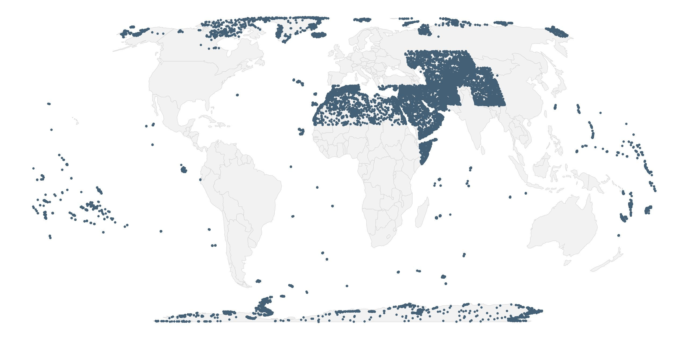

# EcoTrain: Training and Validation Dataset

<p align="center">
  
</p>


## Overview

The **EcoTrain Training and Validation Dataset** provides reference data for the study, modelling, and mapping of **Ecosystem Functional Groups**, based on the **[IUCN Global Ecosystem Typology (GET)](https://global-ecosystems.org)**. It is designed to support a wide range of applications in ecosystem analysis, research, and environmental decision-making. The dataset is structured for interoperability, allowing integration with common geospatial and analytical tools. By providing standardised, high-quality data on Ecosystem Functional Groups, EcoTrain enables consistent and reliable analyses across the world, supporting both scientific research and practical environmental management.


## Download the dataset

<br>
<p align="center">
  <a href="https://github.com/Global-Ecosystems-Atlas/ecotrain/wiki/ecotrain-downloads">
    
  </a>
</p>
<br>


## How to cite this dataset

```
-
```


## Documentation

To access the documentation and supporting resources, visit the [EcoTrain wiki](https://github.com/Global-Ecosystems-Atlas/ecotrain/wiki).


## Release notes

To view the latest changes and updates to the dataset, visit the [release notes](https://github.com/Global-Ecosystems-Atlas/ecotrain/releases) page.


## Follow progress

To follow the development of the dataset, use the [Training Data Viewer](https://geo-global-ecosystems-atlas.projects.earthengine.app/view/trainingdataviewer) and the [Training Data Dashboard](https://lookerstudio.google.com/reporting/b6fd8fb9-9b81-45d8-a99f-36b88dcd80e1/page/MIJeF).


## Report an issue

To report an error or inconsistency in the dataset, open a new issue on the [issue tracker](https://github.com/Global-Ecosystems-Atlas/ecotrain/issues).


## Contact

To ask a question about the dataset, contact [William Masson](mailto:william.masson@jcu.edu.au) or [Nick Murray](mailto:nicholas.murray@jcu.edu.au).
